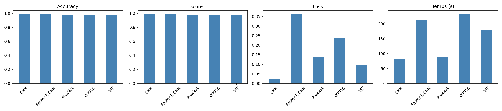

# Lab 2 – Deep Learning : CNN, Faster R-CNN, VGG16/AlexNet et ViT sur MNIST

## Objectif
Construire et comparer plusieurs architectures de vision par ordinateur (CNN, Faster R-CNN, modèles pré-entraînés, Vision Transformer) sur le dataset MNIST, en mode GPU.

## Architectures et hyperparamètres

| Modèle | Description | Entraînement |
|---|---|---|
| CNN | 2 convolutions (3×3, padding 1) + MaxPool 2×2, Dropout 0,25, FC 128 → 10 (421 642 paramètres) | Adam (lr 1e-3, weight decay 1e-4), 5 epochs, 60 000 images |
| Faster R-CNN | MobileNetV3-FPN pré-entraîné, nouvelle tête à 11 classes ; boîtes englobantes générées en plaçant chaque chiffre sur un canevas 128×128 | SGD (lr 0,005, momentum 0,9), 3 epochs, 8 000 images |
| AlexNet | Pré-entraîné ImageNet, convolutions gelées, nouvelle couche de sortie | Adam, 3 epochs, 10 000 images (224×224) |
| VGG16 | Pré-entraîné ImageNet, convolutions gelées, nouvelle couche de sortie | Adam, 3 epochs, 10 000 images (224×224) |
| ViT (from scratch) | Patchs 7×7, dimension 64, 4 blocs, 4 têtes, token CLS (139 018 paramètres) | Adam (lr 5e-4), 10 epochs, 60 000 images |

## Résultats

| Modèle | Accuracy | F1-score | Loss | Temps (s) |
|---|---|---|---|---|
| CNN | 0,9913 | 0,9913 | 0,0244 | 82,5 |
| Faster R-CNN | 0,9865 | 0,9866 | 0,3638 | 212,2 |
| AlexNet | 0,9700 | 0,9701 | 0,1403 | 88,2 |
| VGG16 | 0,9700 | 0,9703 | 0,2352 | 233,8 |
| ViT | 0,9696 | 0,9694 | 0,0990 | 181,3 |

## Interprétation

- **CNN** : meilleur modèle sur toutes les métriques et le plus rapide. MNIST est une tâche simple (28×28, un canal), qu'un CNN léger résout très bien.
- **Faster R-CNN** : très bonne accuracy (98,65 %), mais c'est un modèle de détection, donc plus lourd et plus long à entraîner. Sa loss est la somme de plusieurs termes (classification et régression de boîtes) et n'est pas comparable à celle des classifieurs.
- **AlexNet et VGG16** : 97 % avec le même score, mais VGG16 est environ 2,6 fois plus lent et sa loss est plus élevée. Les convolutions gelées viennent d'ImageNet (photos naturelles) et ne sont pas adaptées aux chiffres manuscrits ; seul le classifieur final a été entraîné. Le transfer learning est surdimensionné ici.
- **ViT** : 96,96 %, au niveau des modèles pré-entraînés mais en dessous du CNN. Il a 3 fois moins de paramètres que le CNN, mais, sans le biais inductif des convolutions (localité, invariance par translation), il doit apprendre ces propriétés à partir des données et demande plus d'epochs.

**Conclusion** : sur MNIST, un CNN simple offre le meilleur compromis précision/coût. Les modèles pré-entraînés et le ViT seraient plus avantageux sur des images plus complexes ou des datasets plus grands.

## Limites
- Les modèles n'utilisent pas les mêmes sous-ensembles ni le même nombre d'epochs (CNN et ViT : 60 000 images ; Faster R-CNN : 8 000 ; AlexNet/VGG16 : 10 000 ; évaluation sur 2 000 images pour ces trois derniers), donc la comparaison n'est pas parfaitement équitable.
- Faster R-CNN a été adapté à MNIST de manière synthétique (boîtes générées).
- Un seul entraînement par modèle, sans validation croisée.

## Synthèse personnelle
Ce lab m’a permis de me familiariser avec PyTorch et l’entraînement de réseaux de neurones sur GPU avec Google Colab. J’ai construit un CNN et compris l’effet des couches de convolution, du pooling, du dropout et de l’optimiseur. En adaptant Faster R-CNN à MNIST, j’ai vu la différence entre classification et détection d’objets, et la difficulté de préparer des données avec boîtes englobantes. Le fine-tuning d’AlexNet et de VGG16 m’a montré le principe du transfer learning (geler les couches, remplacer la dernière), mais aussi que des modèles pré-entraînés lourds ne sont pas toujours meilleurs sur une tâche simple. Enfin, en implémentant un ViT from scratch (patchs, token CLS, embeddings de position, attention multi-têtes), j’ai compris pourquoi il demande plus de données et d’epochs qu’un CNN. J’ai aussi appris à comparer des modèles avec plusieurs métriques et à rester attentive aux limites d’une comparaison.
